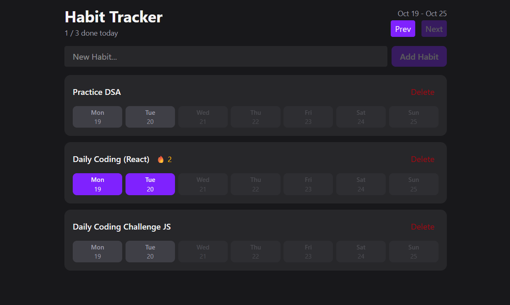

# Habit Tracker

> A sleek, minimalist weekly habit tracker built with React, TypeScript, and Tailwind CSS to help you build consistency and maintain daily streaks.
> Guide: [Habit Tracker - Web Dev Simplified](https://www.youtube.com/watch?v=9aTRnV6g0eQ)

---

## 📖 Project Description

**Habit Tracker** is a lightweight web application designed for tracking daily habits across a weekly calendar view. It enables users to create custom habits, check off daily completions, monitor consecutive day streaks, and browse past weeks—all persisted automatically in the browser's `localStorage`.

### Key Features
- **Weekly Calendar View**: View and toggle habit completions across a Monday–Sunday week layout (`date-fns`).
- **Streak Tracking**: Automatically calculates and displays your active daily streak (`🔥`) for each habit.
- **Daily Progress Counter**: Shows how many habits you have completed today out of your total list (`X / Y done today`).
- **Week Navigation**: Navigate backward and forward through weeks (`Prev` / `Next`) with future dates safely disabled.
- **Persistent Storage**: Habits and completion history are saved to `localStorage` via a custom [`useLocalStorage`](src/hooks/useLocalStorage.ts) hook.

### Tech Stack
- **Frontend**: React 19, TypeScript
- **Styling**: Tailwind CSS v4, `tailwind-merge`
- **Date Utilities**: `date-fns`
- **Build & Tooling**: Vite, React Compiler, Oxlint

---

## 📸 Visual Demo / Screenshot

> _Replace `./public/screenshot.png` below with an actual screenshot or GIF of the running application._



---

## 🛠️ Installation Guide

### Prerequisites
- [Node.js](https://nodejs.org/) (v18 or higher recommended)
- `npm` (included with Node.js)

### Steps

1. **Clone the repository**
   ```bash
   git clone <your-repository-url>
   cd HabitTracker
   ```

2. **Install dependencies**
   ```bash
   npm install
   ```

3. **Start the development server**
   ```bash
   npm run dev
   ```

4. **Open in browser**
   Navigate to the local URL shown in your terminal (typically `http://localhost:5173`).

### Available Scripts
| Command | Description |
| :--- | :--- |
| `npm run dev` | Starts the Vite development server with Hot Module Replacement (HMR) |
| `npm run build` | Type-checks with TypeScript and bundles the app for production |
| `npm run preview` | Locally previews the production build |
| `npm run lint` | Runs `oxlint` to check for code quality and React rules |

---

## 🚀 Usage Instructions

1. **Add a New Habit**
   - Type the name of a habit (e.g., *"Drink 2L of water"*, *"Morning run"*) into the **New Habit...** input field at the top of the page.
   - Click **Add Habit** (or press `Enter`).

2. **Log Daily Completions**
   - Each habit card displays buttons for the 7 days of the currently selected week (**Mon–Sun**).
   - Click on a day button to mark the habit as completed for that date (highlighted in violet). Click it again to undo.
   - Future dates are disabled so completions can only be logged for today or past dates.

3. **Track Your Streaks & Daily Progress**
   - Completing a habit today and on consecutive previous days builds a streak badge (`🔥 <count>`) next to the habit name.
   - Check the header subtitle (`X / Y done today`) to see your overall progress for the current day.

4. **Review Past Weeks**
   - Use the **Prev** and **Next** buttons in the top-right corner to inspect or update habit completions from previous weeks.

5. **Delete a Habit**
   - Click the **Delete** button on the top-right of any habit card to permanently remove it from your tracker.

## 🛠️ Installation Guide

### Prerequisites
- [Node.js](https://nodejs.org/) (v18 or higher recommended)
- `npm` (included with Node.js)

### Steps

1. **Clone the repository**
   ```bash
   git clone <your-repository-url>
   cd HabitTracker
   ```

2. **Install dependencies**
   ```bash
   npm install
   ```

3. **Start the development server**
   ```bash
   npm run dev
   ```

4. **Open in browser**
   Navigate to the local URL shown in your terminal (typically `http://localhost:5173`).

### Available Scripts
| Command | Description |
| :--- | :--- |
| `npm run dev` | Starts the Vite development server with Hot Module Replacement (HMR) |
| `npm run build` | Type-checks with TypeScript and bundles the app for production |
| `npm run preview` | Locally previews the production build |
| `npm run lint` | Runs `oxlint` to check for code quality and React rules |

---

## 🚀 Usage Instructions

1. **Add a New Habit**
   - Type the name of a habit (e.g., *"Drink 2L of water"*, *"Morning run"*) into the **New Habit...** input field at the top of the page.
   - Click **Add Habit** (or press `Enter`).

2. **Log Daily Completions**
   - Each habit card displays buttons for the 7 days of the currently selected week (**Mon–Sun**).
   - Click on a day button to mark the habit as completed for that date (highlighted in violet). Click it again to undo.
   - Future dates are disabled so completions can only be logged for today or past dates.

3. **Track Your Streaks & Daily Progress**
   - Completing a habit today and on consecutive previous days builds a streak badge (`🔥 <count>`) next to the habit name.
   - Check the header subtitle (`X / Y done today`) to see your overall progress for the current day.

4. **Review Past Weeks**
   - Use the **Prev** and **Next** buttons in the top-right corner to inspect or update habit completions from previous weeks.

5. **Delete a Habit**
   - Click the **Delete** button on the top-right of any habit card to permanently remove it from your tracker.

